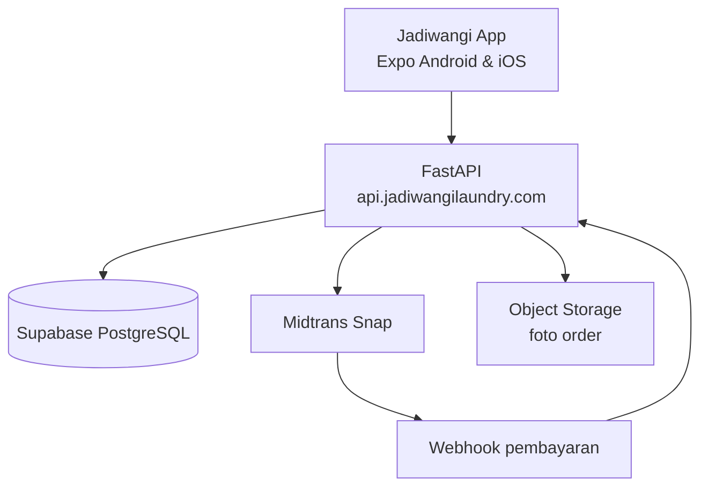
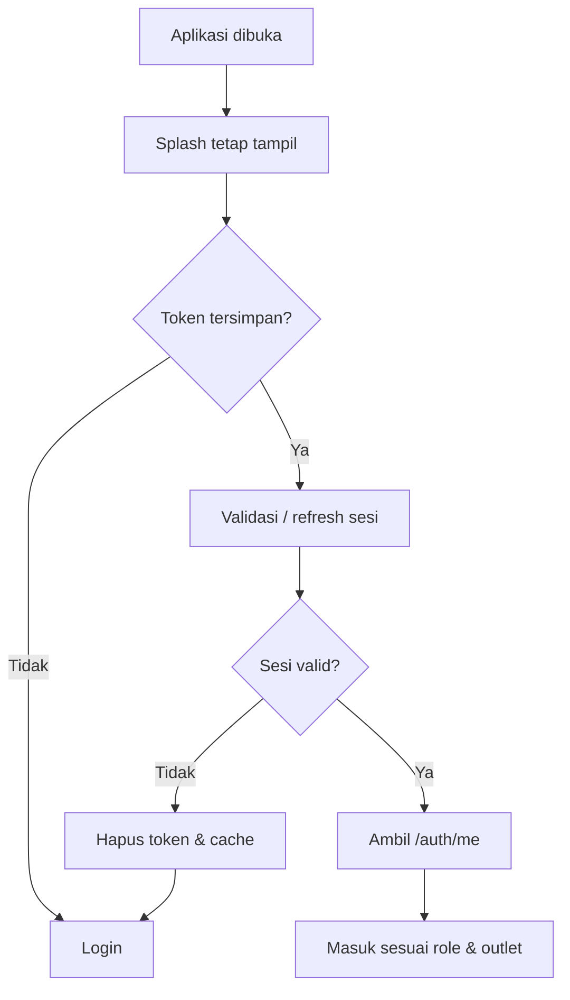
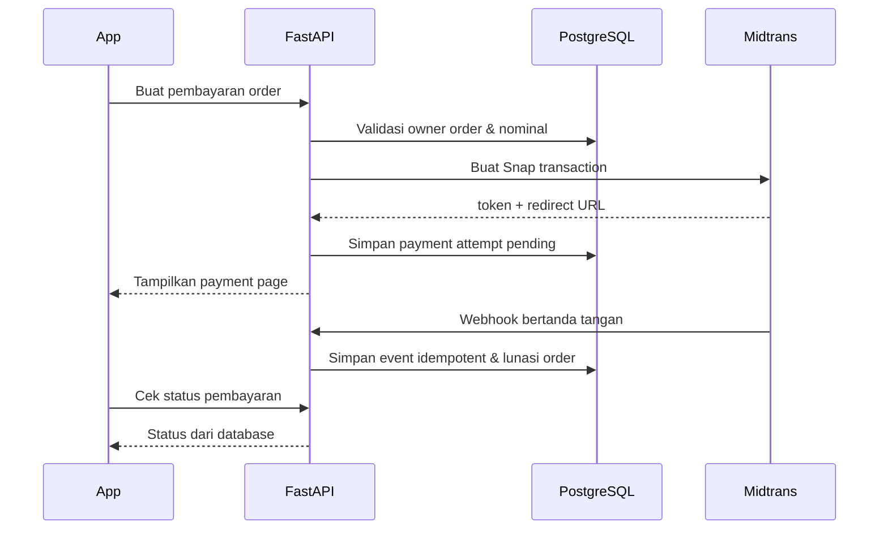

# Arsitektur Jadiwangi App

> Blueprint teknis untuk satu aplikasi Android/iOS dengan tiga role: **owner**, **pegawai**, dan **pelanggan**.
>
> Status: dokumen rancangan — belum memindahkan file produksi.  
> Acuan branch: `Jadiwangi-App`  
> Tanggal pemetaan: 24 Oktober 2026

## 1. Ringkasan sistem

Jadiwangi App menggunakan satu aplikasi Expo/React Native. Setelah sesi pengguna tervalidasi, aplikasi mengarahkan pengguna ke ruang kerja sesuai role. Aplikasi mobile tidak boleh terhubung langsung menggunakan kredensial database; seluruh operasi bisnis melewati FastAPI.



### Batas tanggung jawab

| Lapisan | Tanggung jawab |
|---|---|
| Mobile | Tampilan, navigasi, cache lokal, SecureStore, pengambilan foto, antrean sinkronisasi |
| FastAPI | Autentikasi, otorisasi role/outlet, aturan bisnis, validasi harga, pembayaran, laporan |
| Supabase PostgreSQL | Data utama, constraint, index, transaksi, RLS sebagai pertahanan tambahan |
| Midtrans | QRIS, GoPay, Virtual Account, status pembayaran |
| Storage | Foto order dengan akses terkontrol dan masa simpan |
| GitHub Actions | Lint, test, audit dependency, dan pemeriksaan secret |

## 2. Struktur GitHub saat ini

Repository: `beruangmuda/Jadiwangi`

```text
Jadiwangi
├── Utama                         # default branch; README saja
├── Jadiwangi-App                 # Expo mobile + FastAPI
├── Jadiwangi-Dashboard           # dashboard/backroom
└── Landing-Page-Jadiwangi-Laundry
```

Branch terpisah tersebut sedang dipakai seperti produk yang berbeda. Struktur ini dapat dipertahankan sementara agar deployment Cloudflare/Emergent tidak terganggu. Untuk jangka panjang, pilih salah satu:

1. **Monorepo**: mobile, dashboard, landing page, dan API menjadi folder di satu branch utama.
2. **Multi-repo**: setiap produk menjadi repository tersendiri.

Jangan langsung memindahkan branch produksi sebelum konfigurasi deployment dan environment dicatat.

## 3. Kondisi branch Jadiwangi-App saat ini

```text
Jadiwangi-App
├── frontend/                     # Expo Router / React Native
│   ├── app/
│   │   ├── login.tsx
│   │   ├── (customer)/
│   │   ├── (employee)/
│   │   ├── (owner)/
│   │   ├── manage/
│   │   ├── order-detail/
│   │   ├── proses/
│   │   └── timbang/
│   ├── src/
│   │   ├── api.ts
│   │   ├── auth.tsx
│   │   ├── query-client.ts
│   │   ├── orderSync.ts
│   │   └── components/
│   └── assets/
├── backend/
│   ├── server.py                 # API, SQL, auth, pembayaran, laporan masih menyatu
│   ├── requirements.txt
│   └── tests/
├── tests/
└── test_reports/
```

Struktur ini cukup untuk prototipe, tetapi akan sulit dirawat ketika outlet, pengguna, dan transaksi bertambah. Target berikut memecah kode berdasarkan domain tanpa mengubah fitur pengguna.

## 4. Struktur target yang direkomendasikan

Tahap pertama tetap memakai folder `frontend` dan `backend` agar deployment yang ada tidak langsung rusak.

```text
Jadiwangi-App
├── frontend/
│   ├── app/                              # Hanya route/screen Expo Router
│   │   ├── _layout.tsx                   # Provider + global auth gate
│   │   ├── index.tsx                     # Splash/session resolver
│   │   ├── (public)/
│   │   │   ├── login.tsx
│   │   │   └── register.tsx
│   │   ├── (customer)/
│   │   │   ├── index.tsx
│   │   │   ├── pesan.tsx
│   │   │   ├── riwayat.tsx
│   │   │   ├── bayar.tsx
│   │   │   └── coin.tsx
│   │   ├── (employee)/
│   │   │   ├── index.tsx
│   │   │   ├── order-baru.tsx
│   │   │   ├── proses.tsx
│   │   │   └── kurir.tsx
│   │   └── (owner)/
│   │       ├── index.tsx
│   │       ├── order.tsx
│   │       ├── laporan.tsx
│   │       ├── gaji.tsx
│   │       └── setelan.tsx
│   ├── src/
│   │   ├── core/
│   │   │   ├── api/client.ts             # Bearer token, timeout, retry terbatas
│   │   │   ├── auth/session.ts            # SecureStore + refresh
│   │   │   ├── query/client.ts
│   │   │   ├── config/env.ts
│   │   │   └── navigation/guards.ts
│   │   ├── features/
│   │   │   ├── auth/
│   │   │   ├── orders/
│   │   │   ├── payments/
│   │   │   ├── coin/
│   │   │   ├── customers/
│   │   │   ├── employees/
│   │   │   ├── outlets/
│   │   │   ├── reports/
│   │   │   └── payroll/
│   │   ├── components/
│   │   ├── hooks/
│   │   ├── types/
│   │   └── utils/
│   ├── assets/
│   ├── app.json
│   └── package.json
│
├── backend/
│   ├── app/
│   │   ├── main.py                       # Membuat FastAPI dan memasang router
│   │   ├── core/
│   │   │   ├── config.py                 # Membaca environment/secrets
│   │   │   ├── security.py               # JWT, password hash, token validation
│   │   │   ├── logging.py
│   │   │   └── errors.py
│   │   ├── api/
│   │   │   ├── deps.py                   # current_user, require_role/outlet
│   │   │   └── routers/
│   │   │       ├── auth.py
│   │   │       ├── orders.py
│   │   │       ├── payments.py
│   │   │       ├── midtrans_webhook.py
│   │   │       ├── coin.py
│   │   │       ├── customers.py
│   │   │       ├── employees.py
│   │   │       ├── outlets.py
│   │   │       ├── reports.py
│   │   │       └── payroll.py
│   │   ├── schemas/                      # Pydantic request/response
│   │   ├── services/                     # Aturan bisnis dan transaksi
│   │   ├── repositories/                 # Query PostgreSQL
│   │   ├── integrations/
│   │   │   ├── midtrans.py
│   │   │   └── storage.py
│   │   └── db/
│   │       ├── pool.py
│   │       └── transaction.py
│   ├── tests/
│   │   ├── unit/
│   │   ├── integration/
│   │   └── security/
│   └── requirements.txt
│
├── supabase/
│   ├── migrations/                       # Satu sumber perubahan schema
│   ├── seed.sql                          # Hanya data pengujian
│   └── tests/
│       └── rls/                           # Pengujian akses tiap role
│
├── docs/
│   ├── ARSITEKTUR-JADIWANGI-APP.md
│   ├── API.md
│   ├── DATABASE.md
│   ├── PAYMENT-FLOW.md
│   └── RUNBOOK.md
│
├── .github/
│   └── workflows/
│       ├── frontend-ci.yml
│       ├── backend-ci.yml
│       └── secret-scan.yml
├── .env.example                          # Nama variabel saja; tanpa nilai rahasia
├── .gitignore
└── README.md
```

## 5. Pembagian akses tiga role

| Fitur/data | Pelanggan | Pegawai | Owner |
|---|---:|---:|---:|
| Melihat profil sendiri | Ya | Ya | Ya |
| Membuat permintaan laundry | Ya | Sesuai outlet | Ya |
| Melihat order | Milik sendiri | Outlet penugasan | Semua outlet |
| Mengubah tahap produksi | Tidak | Sesuai izin dan outlet | Ya |
| Membayar order | Milik sendiri | Mencatat pembayaran outlet | Ya |
| Jadiwangi Coin | Saldo sendiri | Tidak boleh mengubah saldo | Audit/approval |
| Data pelanggan | Diri sendiri | Minimum untuk operasional | Ya |
| Laporan keuangan | Tidak | Tidak | Ya |
| Gaji, kasbon, pegawai | Tidak | Diri sendiri bila disediakan | Ya |
| Pengaturan outlet/harga | Tidak | Tidak | Ya |

Pengecekan role di tampilan hanya untuk pengalaman pengguna. Keputusan izin final selalu dilakukan FastAPI pada setiap endpoint.

## 6. Flow autentikasi yang dituju



Ketentuan minimum:

- access token berumur pendek;
- refresh token mempunyai rotation dan dapat dicabut;
- token disimpan dengan Expo SecureStore;
- API client mengirim `Authorization: Bearer <access_token>`;
- logout mencabut sesi di backend dan membersihkan SecureStore, cache, serta navigation stack;
- claim role tidak dipercaya sendirian: status pengguna, role, dan outlet dikonfirmasi backend;
- deep link tetap melewati global auth guard;
- password tidak pernah disimpan atau dikirim kembali dalam response.

## 7. Struktur data per domain

Database aktif saat pemetaan memiliki 18 tabel public dan seluruhnya sudah berstatus RLS enabled. RLS tetap perlu diuji dengan policy untuk tiap role, karena backend memakai koneksi PostgreSQL langsung.

| Domain | Tabel saat ini / target |
|---|---|
| Master | `outlets`, `services`, `app_config` |
| Pengguna | `customers`, `employees`; target tambahan `user_sessions` |
| Operasional | `orders`, `order_items`, `work_logs` |
| Keuangan | `transactions`, `expenses`, `adjustments` |
| SDM | `attendance`, `payroll_manual`, `kasbon` |
| Promosi | `promos`, `vouchers`, `reviews` |
| Coin | `topups`; target `wallet_accounts` dan `wallet_ledger` |
| Payment gateway | kolom Midtrans pada order; target `payment_attempts` dan `payment_events` |

### Jadiwangi Coin

Saldo tidak sebaiknya hanya bergantung pada angka `customers.deposit`. Gunakan ledger immutable:

- setiap top-up menghasilkan baris kredit;
- pembayaran coin menghasilkan baris debit;
- refund menghasilkan kredit baru, bukan mengubah riwayat;
- setiap baris memakai `idempotency_key`;
- perubahan saldo dan transaksi order dilakukan dalam satu transaksi database;
- `balance_cached` boleh disimpan untuk performa, tetapi total ledger tetap dapat diaudit.

## 8. Flow pembayaran Midtrans



Redirect dari halaman pembayaran bukan bukti pelunasan. Status final hanya berubah setelah webhook valid, nominal cocok, dan event belum pernah diproses.

## 9. Strategi performa dan offline

Jangan menyalin seluruh database ke HP atau baru mengirim perubahan setiap pukul 21.00.

Gunakan pola berikut:

- cache hanya data yang dibutuhkan layar;
- query selalu dibatasi `outlet_id`, status, rentang tanggal, cursor, dan limit;
- simpan draft/foto sementara secara lokal;
- antrekan offline hanya untuk aksi operasional yang aman diulang;
- setiap mutation memiliki idempotency key;
- sinkronkan saat koneksi kembali dan saat aplikasi kembali aktif;
- pembayaran, saldo coin, perubahan harga, dan laporan keuangan harus dikonfirmasi server secara real-time;
- index disediakan untuk foreign key dan filter yang sering dipakai;
- gunakan connection pool berukuran terbatas.

## 10. Environment dan secret

```text
Frontend (boleh diketahui aplikasi)
EXPO_PUBLIC_BACKEND_URL=

Backend only
SUPABASE_DB_HOST=
SUPABASE_DB_PORT=
SUPABASE_DB_NAME=
SUPABASE_DB_USER=
SUPABASE_DB_PASSWORD=
JWT_SECRET=
MIDTRANS_SERVER_KEY=
MIDTRANS_IS_PRODUCTION=
```

Repository ini bersifat public. Jangan pernah commit file `.env`, JWT secret, password PostgreSQL, Midtrans Server Key, Supabase secret/service key, atau credential storage.

## 11. Tahapan implementasi

### Fase 1 — keamanan sebelum produksi

1. JWT access + refresh session.
2. Bearer token pada seluruh request.
3. Dependency `current_user`, `require_role`, dan `require_outlet`.
4. Proteksi seluruh endpoint termasuk upload dan file.
5. Tes akses silang pelanggan, pegawai, owner, outlet, dan deep link.

### Fase 2 — modularisasi tanpa perubahan fitur

1. Pecah `backend/server.py` menjadi router, service, dan repository.
2. Pecah screen besar menjadi feature module dan komponen.
3. Pindahkan SQL schema dari startup aplikasi ke migration.
4. Pertahankan contract API agar aplikasi tetap berjalan selama migrasi.

### Fase 3 — pembayaran dan Coin

1. Tambahkan `payment_attempts` dan `payment_events`.
2. Tambahkan wallet ledger yang dapat diaudit.
3. Uji webhook berulang, nominal salah, pembayaran kedaluwarsa, refund, dan race condition.

### Fase 4 — performa dan operasi

1. Pagination, index, cache scope per role/outlet.
2. CI frontend/backend dan secret scanning.
3. Monitoring error, backup/restore test, serta runbook insiden.
4. Build internal Android/iOS sebelum distribusi production.

## 12. Definition of done sebelum release

- pengguna tanpa token tidak dapat memanggil endpoint private;
- pelanggan tidak dapat membaca order pelanggan lain;
- pegawai tidak dapat membaca atau mengubah outlet lain;
- pegawai tidak dapat membuka laporan owner;
- token kedaluwarsa ditangani tanpa loop;
- logout mencabut sesi dan tombol Back tidak membuka halaman lama;
- webhook Midtrans idempotent;
- saldo Coin dapat direkonsiliasi dengan ledger;
- tidak ada secret dalam Git history, bundle Expo, log, atau response API;
- migration dapat dijalankan dari database kosong;
- backup dan restore pernah diuji.
